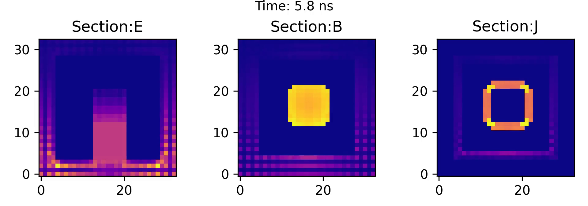

# FDTDCurrent

A library for numerically modelling how charge redistributes in a conductor over very short timescales, where the inertia of the charge carriers must be taken into account. A curiosity project, now paused.

```
pip install fdtdcurrent
```

## Physics

Ohm's law assumes the current responds instantly to the field. In copper, the carriers' momentum relaxation time is τ = mσ/(ne²) ≈ 25 fs, so that assumption fails on shorter timescales. Ohm's law even predicts that free charge leaves a conductor's interior in ε₀/σ ≈ 10⁻¹⁹ s, far shorter than τ itself. Instead of Ohm's law, this library evolves the current with a Drude-type momentum equation, including carrier inertia and a convective term, coupled to Maxwell's equations:

```math
\begin{aligned}
\partial_t \mathbf{E} &= c^2\left(\nabla\times\mathbf{B} - \mu_0\mathbf{J}\right)\\
\partial_t \mathbf{B} &= -\nabla\times\mathbf{E}\\
\partial_t \mathbf{J} &= s\left(\rho_f(\mathbf{E}+\mathbf{K}) + \mathbf{J}\times\mathbf{B} - \frac{\rho_f}{\sigma}\mathbf{J}\right) - \frac{(\mathbf{J}\cdot\nabla)\mathbf{J}}{\rho_f}
\end{aligned}
```

Here $s$ is the carriers' specific charge, $\rho_f$ the free-carrier charge density, $\sigma$ the conductivity, and $\mathbf{K}$ an applied EMF; the $\mathbf{J}$ equation applies only inside conductors. The fields live on a collocated grid and are stepped with a Crank–Nicolson leap-frog scheme: the linear terms are implicit, using a sparse solve, and the nonlinear terms are explicit. My rough derivation notes, written for my own use and unfinished, are in [`docs/derivation_notes.pdf`](docs/derivation_notes.pdf).

The examples run on macroscopic grids (centimetre cells, nanosecond times), where inertia barely matters. At the femtosecond and nanometre scales where it does, effects this model leaves out also become important, such as the bound-electron response and nonlocality.


*Example run: a square copper loop with an EMF switched on in one side. The panels show the magnitudes of E, B and J in the plane of the loop, 5.8 ns after switch-on (axes in grid cells).*

## Usage

1. Run a grid
```
import numpy as np

from fdtdcurrent import Grid, Conductor, Source, Detector
from fdtdcurrent.detector import Detectable


# time-independent emf of 1 V/m in the +x direction
def my_emf(positions: np.ndarray, time: float):
    res = np.zeros_like(positions, float)
    res[0] = 1
    return res


# the free charge density, charge carrier specific charge, and conductivity of copper in SI
copper_rho_s_sigma = (8.5e28 * -1.6e-19, -1.6e-19 / 9e-31, 8e7)
size = 1.0  # size of the grid in meters
thickness = size / 4
grid = Grid("ExampleGrid", (size, size, size), 5e-2)
# region conductor slab in the middle x plane
xslice = slice(size / 2 - thickness / 2, size / 2 + thickness / 2)
grid[xslice, :, :] = Conductor("testConductor1", *copper_rho_s_sigma)
# endregion
# apply my_emf in the 1st quadrant (y>size/2, z>size/2) of the conductor slab
grid[xslice, size / 2:, size / 2:] = Source("testSource", my_emf)
# add a detector to the middle x plane, detecting the x component of the electric field
det = Detector("det1", [Detectable.Ex])
grid[size / 2, :, :] = det


def trigger():
    data = det.values
    pass  # do something with the values read by the detector while the grid is running if you want


grid.run(200, save=True)  # run the grid for 200 steps, saving the state at each step to a file
```
2. Plot the results
```
from fdtdcurrent import Grid, Detector
from fdtdcurrent.detector import Detectable
from fdtdcurrent.visualization import animate

grid = Grid.load_from_file("ExampleGrid.dat")
# the detector we added before running the grid gets restored when loading it from a file

grid[1,1:-1,1:-1] = Detector("lowx", [Detectable.Bx]) # pick a subset of the grid to detect
animate(grid, time=120, fps=1) # produce an animation of the detector values on the grid that
# lasts 120 seconds with 1 frame per second
```
